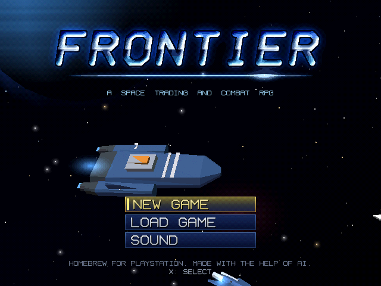
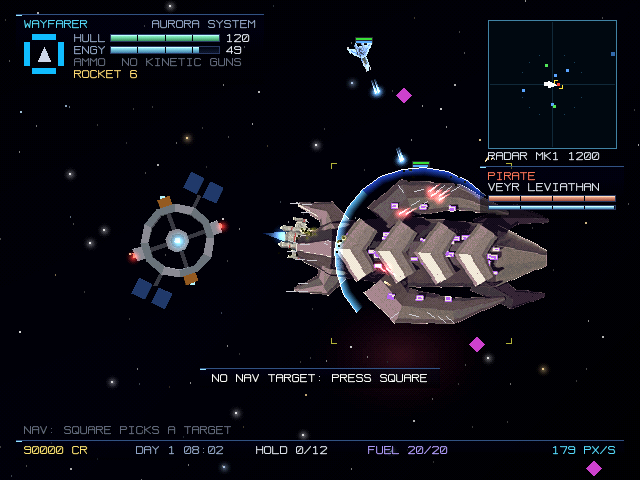
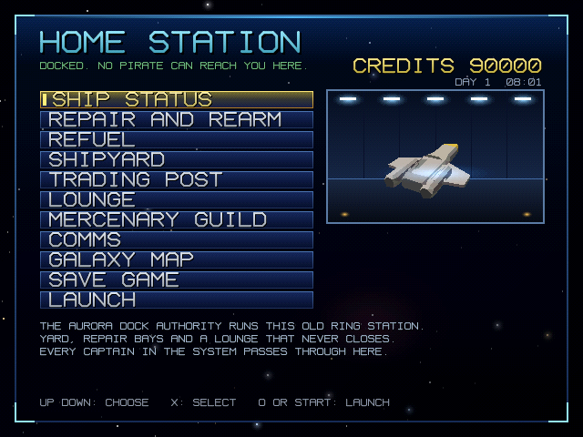
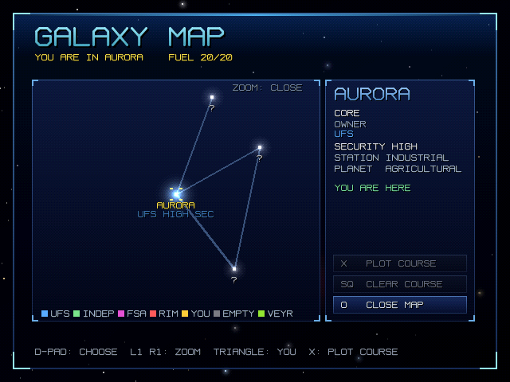

<p align="center"></p>

<p align="center"><b>A space trading and combat RPG for the Sony PlayStation (PS1)</b></p>

FRONTIER is a homebrew game for original PlayStation hardware, written in C with
[PSn00bSDK](https://github.com/Lameguy64/PSn00bSDK). You start with a ship, a little money
and a lot of problems. Trade between dozens of worlds, run contraband past Federation patrols,
hunt pirates for their bounties, board and claim disabled ships, build a fleet of named pilots,
and pick a side, if one will have you. Then the Veyr arrive, and everything you've built has to
stand against them.

<p align="center">




</p>

## Features

- **An open galaxy:** 64 star systems linked by hyperspace, split between the UFS
  (the Federation), the FSA (the Free States), the Outer Rim Syndicates and independent
  colonies, plus five hidden systems past the Rim.
- **Real-time flight and combat:** four-arc shields, location damage to engines, reactors,
  weapons and individual modules, guns that track your target, rockets, seekers and ion missiles.
- **Disable, board and claim:** cripple a ship, then take its cargo, claim it for your fleet or
  strip it for scrap. Some blow themselves up.
- **Trade and smuggling:** 18 goods with prices driven by stock and the clock, cargo scans by
  UFS patrols, and Syndicate black markets.
- **Build your ship:** a grid editor places weapons, engines, reactors, shields and armour on
  each hull, plus upgrades in levels.
- **Fleets:** every ship you buy or claim gets its own pilot who earns rank. Fly them as
  wingmen, or send squadrons to travel, trade or attack.
- **Factions and stories:** three faction story lines lead to an oath you can swear only once.
  Take worlds by force, and they pay you tribute.
- **The Veyr:** an alien invasion that comes for every pilot after ten hours of play, with
  three endings and a war after the war.
- **Four pilots** with their own ships, money and starting systems, and three difficulty
  settings for the Veyr.
- **Music and sound:** five songs and 23 effects, synthesized for the PlayStation's own sound
  chip, with hardware reverb and volume controls.
- **Saves** on the memory card (2 blocks, four slots).

## Status

FRONTIER is in active development (milestone 19a). The game is playable from start to finish
in emulators. Balance and pacing still need a full play-through, and the newest systems
(music and sound in particular) have not yet been tested on real hardware.
[`docs/DEVNOTES.md`](docs/DEVNOTES.md) is the full milestone-by-milestone log and test list.

## Controls

Use a DualShock in analog mode (ANALOG light on). A digital pad works, but can't strafe.

| Button | In flight | In menus |
| --- | --- | --- |
| D-pad or left stick | Turn and thrust | Choose |
| Right stick | Strafe | |
| Left stick click (L3) | Lock on to your target | |
| R2 / L2 | Fire guns / fire the selected missile | |
| R1 / L1 | Next target / change missile type | |
| Cross | Afterburner (hold; burns jump fuel) | Select |
| Circle | Autopilot on or off | Back |
| Triangle | Dock, board a wreck, or jump along your course | |
| Square | Next navigation target | |
| Select | Galaxy map | |
| Start | System menu | |

## Building

You need [PSn00bSDK](https://github.com/Lameguy64/PSn00bSDK) (its releases include the MIPS
compiler and `mkpsxiso`), CMake 3.21 or newer, and Ninja. Point `PSN00BSDK_LIBS` at the SDK's
`lib/libpsn00b` folder and put its `bin` folder on your `PATH`. Then, from the repository root:

```
cmake --preset default . -DCMAKE_BUILD_TYPE=Release
cmake --build ./build
```

This produces `build/frontier.bin` and `build/frontier.cue`, a disc image you can run in an
emulator such as DuckStation or PCSX-Redux, or burn to a CD-R. The preset alone makes a Debug
build, which is noticeably slower, so use Release for playing and measuring.

## Tools

The generated data in `src/` is checked in, so you only need these to change the game's
content. All of them run on a PC with Python 3.

| Folder | What it does |
| --- | --- |
| `tools/galaxy` | Generates the galaxy (`src/galaxy_data.c/.h`) and a map picture |
| `tools/audio` | Synthesizes every instrument and effect, compiles the music (`songs.py`) and encodes it all to SPU ADPCM (`src/audio_data.c/.h`). Needs NumPy and SciPy |
| `tools/shipgen` | Builds the ships as low-poly 3D models in Blender and converts the renders to PS1 sprites and models |
| `tools/artgen` | The title logo and the font |
| `tools/preview` | A PC build of the game that renders frames to images and records its audio to a WAV, driven by scripted button presses. Run `tools/preview/build.sh`; see the top of `host.c` for its options |

## Repository layout

| Path | Contents |
| --- | --- |
| `src/` | The game: flight, combat, AI, docking, trade, galaxy, fleet, missions, story, the Veyr, audio, saves |
| `tools/` | The content and test tools above |
| `docs/DEVNOTES.md` | The development log: what each milestone added and what to test |
| `DESIGN_NOTES.md`, `PILOTS.md` | Design notes and the premade pilots' texts |
| `iso.xml`, `system.cnf` | The disc layout and boot file |

## Credits

- **Concept, design and direction:** Xenocide21
- **Code, ships, music, sound and writing:** made with Claude (Anthropic), with the graphics
  overhaul by Fable
- **Built with** [PSn00bSDK](https://github.com/Lameguy64/PSn00bSDK) and mkpsxiso

## License

MIT, see [LICENSE](LICENSE).

FRONTIER is a homebrew game. It is not licensed, endorsed or published by Sony Interactive
Entertainment. PlayStation and DualShock are trademarks of Sony Interactive Entertainment Inc.
